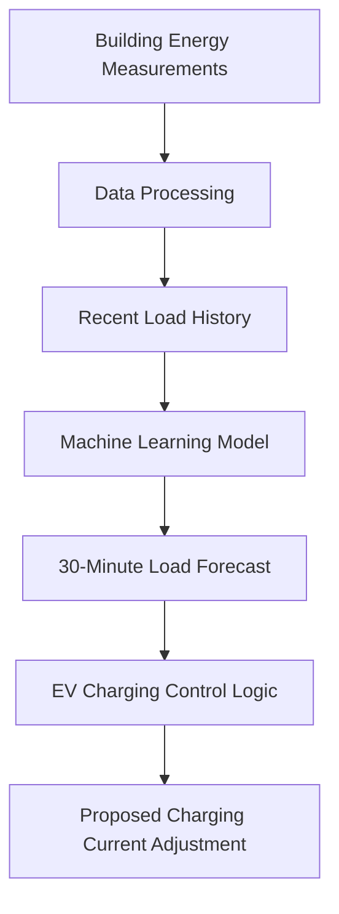

# EV-Load-Forecasting-
Machine Learning based electricity demand forecasting for EV charging stations  
# Short-Term Energy Load Forecasting for EV Charging Management

### Machine Learning | Python | Energy Forecasting | EV Charging

## Project Overview

This project investigates how machine-learning models can predict electrical load approximately **30 minutes into the future** to support intelligent EV charging management.

The objective is to develop a forecasting approach that could help an EV charging controller adjust charging current based on anticipated building electricity demand.

The project uses household energy consumption data recorded at 10-minute intervals as a proxy for building electrical load.

**This is an exploratory machine-learning study, not a deployed EV charging control system.**

## System Concept

The proposed controller would:

1. Collect current and historical building electricity demand.
2. Predict electrical load 30 minutes ahead.
3. Identify periods of potentially high demand.
4. Reduce EV charging current when future demand is expected to be high.
5. Allow higher charging current when electrical capacity is available.

Electrical limits and safety constraints would remain in a separate deterministic control layer.

## Technologies and Methods

- Python
- Pandas and NumPy for data processing
- Scikit-learn for machine-learning experimentation
- Random Forest Regression
- Linear Regression
- Neural Network
- Matplotlib for visualization
- Time-series analysis
- Feature engineering and correlation analysis
- Model evaluation using MAE and RMSE

## Dataset

The investigation uses household electricity measurements recorded every 10 minutes.

The dataset contains appliance electricity consumption, time information, environmental measurements, and indoor sensor data.

The prediction target is electricity consumption approximately 30 minutes ahead.

The dataset is not from a commercial EV charging installation. It was used to demonstrate forecasting methods and investigate which factors most strongly influence short-term load prediction.

## Machine Learning Experiments

Several feature combinations and forecasting models were evaluated.

Initially, a Random Forest model was trained using current electrical load, time, weather, and selected indoor sensor measurements.

Additional features were subsequently introduced to determine whether more information improved forecasting accuracy.

Interestingly, adding many sensor variables worsened prediction performance.

The investigation then focused on historical electrical load:

- Current load
- Load 10 minutes earlier
- Load 20 minutes earlier
- Load 30 minutes earlier

These features produced substantially better forecasts.

## Model Performance

| Model | MAE | RMSE |
|---|---:|---:|
| Random Forest — Basic Features | 87.49 | 129.68 |
| Random Forest — Many Features | 136.80 | 179.95 |
| Random Forest — Lags and Context | 75.29 | 112.41 |
| Random Forest — Load History | 44.92 | 87.95 |
| **Linear Regression** | **39.51** | 80.15 |
| **Neural Network** | 39.60 | **79.09** |

### Key Findings

**Linear Regression achieved the lowest MAE**, while the Neural Network achieved the lowest RMSE.

The two models performed very similarly.

This demonstrates that more complex machine-learning models do not automatically outperform simpler models.

Recent electrical load history was considerably more useful than adding numerous unrelated measurements.

## Feature Correlation Analysis

Correlation analysis showed that current electrical load and recent historical load values were the strongest individual predictors of future demand.

Current load had a correlation of approximately **0.44** with the 30-minute forecasting target.

Environmental variables, including temperature, humidity, and wind speed, showed relatively weak direct correlations.

Rate-of-change features were also investigated but were less informative than recent absolute load values.

## High-Load Event Analysis

An important limitation of short-term energy forecasting is the presence of sudden electricity consumption spikes.

These may be associated with unpredictable human activities, such as switching on household appliances.

Some high-load events showed increasing electricity demand beforehand, while others occurred abruptly.

The study classified future consumption above an experimental threshold of 300 as a high-load event.

Across the dataset:

- High-load observations: 1,131
- Normal-load observations: 18,598

### Average Load Before High-Load Events

| Time Before Event | High-Load Average | Normal Average |
|---|---:|---:|
| 60 minutes | 165.19 | 93.55 |
| 50 minutes | 171.22 | 93.18 |
| 40 minutes | 182.16 | 92.52 |
| 30 minutes | 201.66 | 91.33 |

The results indicate that future high-load events often have
